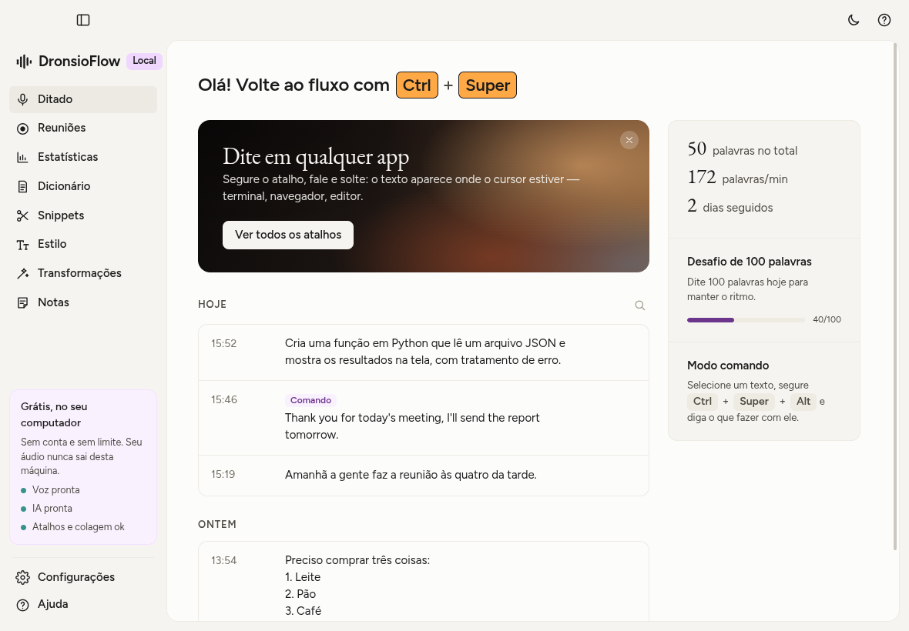
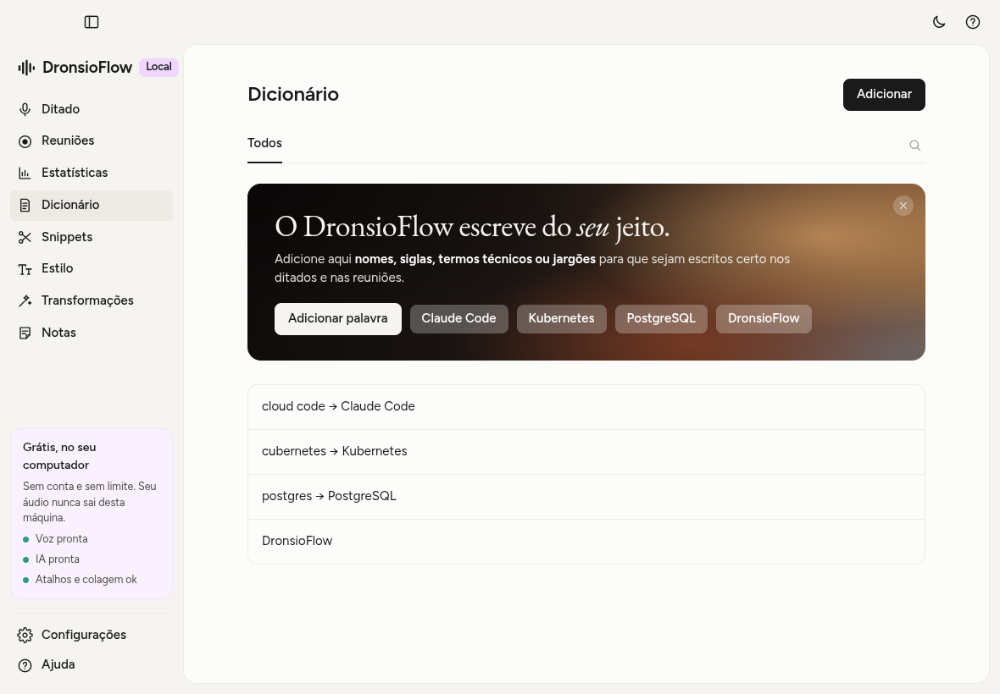
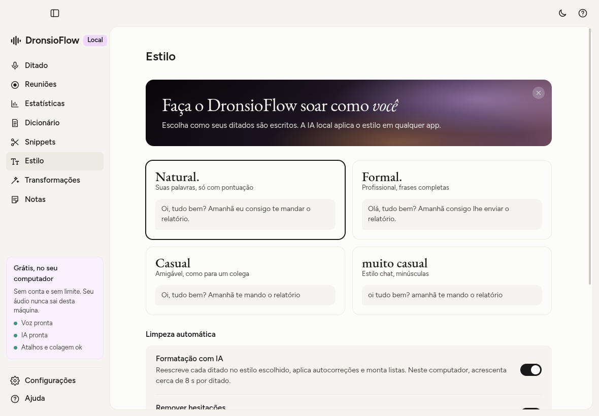
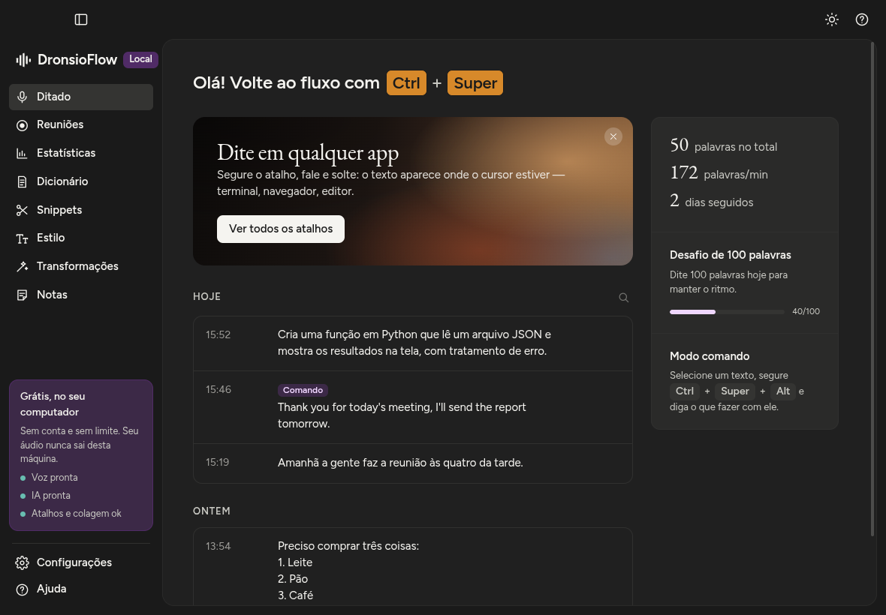
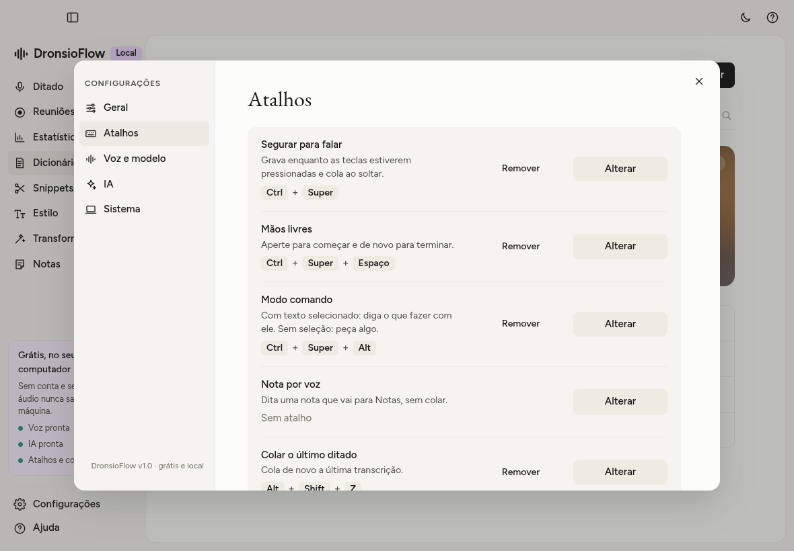

<p align="center">
  
</p>

# DronsioFlow

Ditado por voz **gratuito e 100% local** para Linux. Segure um atalho, fale e solte: o texto é colado onde
o cursor estiver, em qualquer app — terminal, navegador, editor, Claude Code…



- Reconhecimento de voz com **Whisper** ([faster-whisper](https://github.com/SYSTRAN/faster-whisper)) rodando no seu CPU.
- Sem conta, sem limite e sem internet (só para baixar os modelos na primeira vez; o modo agente opcional é a
  exceção). O áudio nunca sai do computador.
- Funciona no **Wayland** (testado no GNOME) e no X11.
- IA local opcional com **[Ollama](https://ollama.com)**: modo comando, transformações, formatação por estilo e
  resumo de reuniões.
- **Modo agente** opcional: fale uma tarefa e o [Claude Code](https://claude.com/claude-code) a executa no computador
  e no navegador (usa a sua conta Claude; veja [Privacidade](#privacidade)).

## Sumário

- [Requisitos](#requisitos) · [Instalação](#instalação) · [Atalhos](#atalhos)
- [Funcionalidades](#funcionalidades) · [Configurações](#configurações) · [Desempenho da IA](#desempenho-da-ia)
- [Privacidade](#privacidade) · [Como funciona](#como-funciona) · [Desenvolvimento](#desenvolvimento)
- [Desinstalar](#desinstalar) · [Licença](#licença)

## Requisitos

- Linux com PipeWire ou PulseAudio
- Node.js 18+ e npm (para baixar o runtime do Electron)
- Python 3.10+ com `venv`
- `parecord`/`pactl` (pacote `pulseaudio-utils`) e `wl-clipboard` (Wayland) ou `xclip` (X11)
- Opcional: Ollama com um modelo instalado (recomendado: `ollama pull gemma4:e2b`)

```bash
# Fedora
sudo dnf install nodejs npm python3 pulseaudio-utils wl-clipboard xclip
# Ubuntu/Debian
sudo apt install nodejs npm python3-venv pulseaudio-utils wl-clipboard xclip
```

## Instalação

```bash
git clone https://github.com/guihassen/DronsioFlow.git
cd DronsioFlow
./install.sh                    # instala em ~/.local/opt/dronsioflow e cria a entrada no menu
sudo ./setup-permissions.sh     # uma vez: acesso ao teclado (atalho global) e ao /dev/uinput (colar)
```

Abra **DronsioFlow** pelo menu de aplicativos (ou rode `dronsioflow`). Na primeira vez, o modelo de voz escolhido
é baixado (Small ≈ 480 MB). O instalador verifica as dependências e avisa o que faltar.

> `setup-permissions.sh` cria uma regra udev que dá ao usuário da sessão ativa acesso aos teclados e ao `/dev/uinput`.
> É o que permite o atalho global e a colagem no Wayland, mas também significa que outros programas do seu
> usuário podem ler o teclado. Para desfazer, veja [Desinstalar](#desinstalar).

Para atualizar: `git pull` e `./install.sh` de novo.

## Atalhos

Funcionam em qualquer app, mesmo com a janela fechada.

| Ação | Atalho padrão | Como funciona |
|---|---|---|
| Segurar para falar | Ctrl + Super | grava enquanto as teclas estão pressionadas e cola ao soltar |
| Mãos livres | Ctrl + Super + Espaço | aperte para começar e de novo para terminar |
| Travar em mãos livres | Espaço durante o "segurar para falar" | continua gravando depois de soltar as teclas |
| Modo comando | Ctrl + Super + Alt (segurar) | instrução falada sobre o texto selecionado (veja abaixo) |
| Nota por voz | sem padrão (defina nas configurações) | dita uma nota que vai para **Notas**, sem colar |
| Modo agente | Ctrl + Super + Shift (segurar) | fala uma tarefa para o Claude Code executar (veja [Modo agente](#modo-agente)); se essa combinação já era sua, o modo fica sem atalho até você escolher um |
| Colar o último ditado | Shift + Alt + Z | cola de novo a última transcrição |
| Copiar o último ditado | Shift + Alt + X | copia a última transcrição |
| Transformações | um atalho por transformação | reescreve o texto selecionado |
| Mudar de estilo | sem padrão (sugestão: Ctrl + Alt + 1…4) | um atalho por estilo e um para alternar entre eles; a barra flutuante mostra o novo estilo |
| Cancelar | Esc | descarta a gravação atual; sem gravação, interrompe o agente |

Os atalhos mudam em **Configurações → Atalhos**. Vale qualquer combinação de teclas, inclusive com os botões
laterais do mouse. Ctrl/Shift/Alt/Super da direita e da esquerda contam como a mesma tecla. Gravações com menos de
0,3 s são ignoradas (toques acidentais), e um ditado tem no máximo 10 minutos.

## Funcionalidades

### Ditado (tela inicial)

- **Ditado instantâneo**: o Whisper já pontua; o app remove hesitações ("hum", "ahn", "é…"), aplica o dicionário e
  os snippets — tudo sem IA, na hora — e cola no app em foco.
- **Histórico** agrupado por dia (Hoje, Ontem, datas), com busca, copiar e apagar cada item. Comandos, transformações
  e notas aparecem marcados.
- **Painel de estatísticas**: palavras no total, palavras por minuto, dias seguidos e o **desafio de 100 palavras
  por dia**.
- Saudação com o seu atalho e um banner de boas-vindas (pode ser fechado).

### Reuniões

- **Gravador de reuniões**: grava o microfone e, se quiser, o **áudio do computador** (as outras pessoas da chamada),
  por até 4 horas.
- Ao parar, transcreve tudo localmente com barra de progresso e, com a IA ligada, escreve um **resumo** com
  resumo, pontos principais, decisões e próximos passos.
- Lista de gravações com busca; cada reunião abre com resumo, transcrição completa, **copiar tudo** e apagar.
- Uma notificação avisa quando a transcrição termina, e um ponto vermelho aparece na barra flutuante e no menu
  enquanto grava.

### Estatísticas

- Palavras ditadas, palavras por minuto, dias seguidos e **minutos economizados** (comparado a digitar a 40 palavras
  por minuto).
- Gráfico dos **últimos 14 dias** e contagem **por tipo**: ditados, comandos, transformações e notas por voz.

### Dicionário



- Termos que devem ser escritos do seu jeito (nomes, siglas, jargões). Eles orientam o Whisper e a IA.
- **"Ouvido como"**: variações que o reconhecimento costuma errar, separadas por vírgula, são corrigidas
  automaticamente ("cloud code" vira "Claude Code"), sem IA.
- Busca e remoção de termos.

### Snippets

- Uma **frase-gatilho** falada vira um texto pronto: e-mail, links, assinaturas, prompts que você repete.
- Funciona tanto com a frase sozinha ("meu email") quanto no meio de um ditado ("manda para o meu email"), ignorando
  maiúsculas, pontuação e hífens ("e-mail" = "email").

### Estilo



- Cinco estilos de escrita, com exemplos: **Natural**, **Formal**, **Casual**, **muito casual** e **Técnico**.
- **Atalhos de estilo**: um atalho para cada estilo e um para **alternar** entre eles (Natural → Formal → Casual →
  Muito casual → Técnico), em qualquer app. A barra flutuante mostra o nome do novo estilo por um instante (e avisa se a
  formatação com IA estiver desligada, já que sem ela o estilo não é aplicado).
- **Técnico**: feito para ditar prompts e ordens a agentes de código como o Claude Code. Frases diretas e
  imperativas, termos técnicos mantidos em inglês (commit, deploy, endpoint), nomes de produtos na grafia oficial,
  números em algarismos e comandos e funções entre `crases`. Também orienta o Whisper com vocabulário de
  desenvolvimento, para "Claude Code" não virar "cloud code".
- **Menções com @** (estilo Técnico): arquivos e pastas citados viram menções do Claude Code. "Olha o arquivo main
  ponto js" vira "Olhe o arquivo @main.js"; "a pasta src barra components" vira "a pasta @src/components/". As
  menções são feitas por regras fixas, não pela IA, então só aparece o que você falou: nenhum caminho é inventado.
- **Formatação com IA** (opcional): reescreve cada ditado no estilo escolhido. A IA nunca responde ao que você dita,
  só formata — dá para ditar prompts para outras IAs.
- **Limpeza automática**: remover hesitações (sem IA), **autocorreções** ("às três, não, às quatro" vira "às
  quatro") e **listas automáticas** ("primeiro…, segundo…" vira lista) — estas duas com IA.
- **Tradução** do ditado para inglês, espanhol, português, francês, alemão ou italiano. Inglês funciona sem IA
  (o próprio Whisper traduz); os outros idiomas usam a IA.

### Transformações

- Selecione um texto em qualquer app e aperte o atalho da transformação: o texto é reescrito no lugar.
- Vêm prontas: **Melhorar escrita**, **Transformar em prompt**, **Mais formal**, **Mais curto**,
  **Corrigir gramática** e **Traduzir para inglês**.
- Crie, renomeie, edite as instruções e exclua transformações; cada uma tem seu próprio atalho.

### Modo comando

- **Com texto selecionado**: segure o atalho e diga o que fazer ("traduz para inglês", "resume em três tópicos",
  "deixa mais educado"); o resultado substitui a seleção.
- **Sem seleção**: peça algo ("escreve um e-mail pedindo para remarcar a reunião") e a resposta é colada.
- Dá para começar no "segurar para falar" e adicionar Alt para virar comando.

A "seleção" usada pelo modo comando e pelas transformações é a seleção primária do Linux: o texto destacado com o
mouse ou o teclado em qualquer app.

### Modo agente

Segure **Ctrl + Super + Shift**, fale uma tarefa e solte: a instrução transcrita vai para o
[Claude Code](https://claude.com/claude-code) instalado no computador, que a executa usando o Chrome (integração
Claude in Chrome) e o terminal. Exemplo: "abra o navegador, vá no WhatsApp Web e mande uma mensagem para a Amanda
perguntando como ela está".

- **Confirmação garantida pelo app**: toda ferramenta que altera algo (comando no terminal, criar ou editar arquivo,
  clicar, digitar, preencher campo ou rodar script no Chrome) é interceptada antes de executar. A janela do
  DronsioFlow vem para a frente mostrando a ação **real**: o comando exato, o caminho e o começo do conteúdo do
  arquivo, o alvo do clique ou o texto digitado, e não a descrição que o modelo deu. Só **Confirmar** deixa
  executar; **Cancelar**, Esc no diálogo ou 5 minutos sem resposta recusam, e o agente termina dizendo o que não fez.
  Isso vale mesmo que uma página ou mensagem tente instruir o agente a agir sozinho. Ler (abrir páginas, pesquisar,
  ler arquivos, capturar a tela) não pede confirmação.
- Antes de enviar mensagem ou e-mail, publicar ou comprar, o agente também para e descreve a ação em uma frase, para
  você confirmar a intenção antes dos cliques.
- **Os outros atalhos seguem funcionando** enquanto o agente trabalha: ditado, comando, nota, transformações e
  colar/copiar o último. Só um agente roda por vez (o atalho avisa se já houver um). Se uma confirmação surgir no meio
  de um ditado, a janela espera o ditado terminar de colar antes de aparecer.
- **Esc** durante uma gravação cancela a gravação; sem gravação, cancela o agente (inclusive os comandos que ele
  começou).
- A resposta final aparece numa notificação e fica no histórico marcada como **Agente** (e conta em Estatísticas).
- Como no modo comando, dá para começar no "segurar para falar" e adicionar Shift.
- Requer o Claude Code instalado e logado (`claude` no PATH ou em `~/.local/bin/claude`) e, para o navegador, a
  extensão Claude in Chrome conectada. Sem o Claude Code, o atalho só mostra um aviso.
- Em **Configurações → IA → Modo agente**: liga/desliga (vem ligado se o `claude` for encontrado), caminho do
  binário e tempo máximo de cada etapa (padrão 10 min).
- Por baixo, o app roda `claude -p` sem shell, num grupo de processos próprio (cancelar ou estourar o tempo encerra
  o `claude` e tudo o que ele abriu). Só ferramentas de leitura são pré-aprovadas; as que alteram algo passam por um
  hook `PreToolUse` (`app/native/agent_hook.js`) que pergunta ao app por um socket Unix privado (pasta 0700, socket
  0600) e, se o app não responder, recusa. Com `--setting-sources ""`, as permissões do seu `~/.claude/settings.json`
  (`permissions.allow`, `defaultMode`) e os hooks e configurações do projeto não valem para o agente; o login da
  conta continua funcionando (fica fora desses arquivos). Nunca `--dangerously-skip-permissions`.

### Notas

- Notas rápidas: crie, edite (salvamento automático), copie, apague e busque.
- Com o atalho de **nota por voz**, o ditado vira uma nota em vez de ser colado, e uma notificação confirma.

### Barra flutuante


Fica no rodapé da tela e mostra o estado sem atrapalhar (os cliques passam através dela):

- **Parada**: um tracinho discreto (pode ser escondido nas configurações).
- **Gravando**: pílula preta com ondas que acompanham a sua voz.
- **Modo comando** (ponto lilás), **nota** (ponto laranja) e **mãos livres** (cadeado).
- **Processando**: três pontinhos.
- **Reunião gravando**: ponto vermelho.
- **Modo agente**: a pílula inteira fica vermelha: com ondas enquanto grava a tarefa, com pontinhos claros enquanto o
  agente trabalha e com a borda pulsando e "Confirme no DronsioFlow" aguardando confirmação. Um ditado durante o
  agente usa a barra normal e, ao terminar, ela volta ao vermelho. O vermelho da reunião é só um ponto ao lado da
  barra parada, então os dois não se confundem.

### Janela e interface



- Tema **claro e escuro** (ou igual ao sistema), alternável pelo botão no topo.
- Barra lateral recolhível, central de **Ajuda** com todos os atalhos e indicadores de estado: voz pronta,
  IA pronta, atalhos e colagem ok.
- Avisos claros quando algo falha (sem permissão de teclado, modelo com erro, IA indisponível, colagem que não deu
  certo, ou **microfone que não envia áudio** — comum com fones Bluetooth cujo link de voz travou). Se a colagem falhar, o texto fica na área de transferência.
- Fechar ou minimizar a janela não desliga o ditado: o app continua em segundo plano. Para reabrir, abra pelo menu
  de aplicativos. Só uma instância roda por vez.
- Ícone na bandeja do sistema nos ambientes que suportam (no GNOME, requer a extensão AppIndicator).

## Configurações



| Aba | Opções |
|---|---|
| **Geral** | atalho de ditado, microfone (**Automático** com fio, **Automático preferindo fone Bluetooth**, padrão do sistema ou um específico, mostrando qual está em uso), idioma falado (português, inglês, espanhol, francês, alemão, italiano ou detecção automática) e tema |
| **Atalhos** | todos os atalhos (inclusive os de estilo), com remover e restaurar padrão. O app recusa um atalho que já está em uso e avisa quando a combinação também chega ao app em foco (como Ctrl+S), já que as teclas não são bloqueadas |
| **Voz e modelo** | modelo do Whisper: Tiny (75 MB), Base (145 MB), Small (480 MB, recomendado), Medium (1,5 GB) ou Large v3 Turbo (1,6 GB), com progresso do download |
| **IA** | liga/desliga a IA local e escolhe o modelo do Ollama; **Modo agente**: liga/desliga, caminho do `claude` e tempo máximo |
| **Sistema** | iniciar com o sistema, sons de início/fim, mostrar a barra quando parado, tecla de colar (Shift+Insert, Ctrl+V ou Ctrl+Shift+V), restaurar a área de transferência, abrir a pasta de dados, apagar o histórico e sair |

A colagem padrão é Shift+Insert, porque o app preenche tanto a área de transferência quanto a seleção primária
(funciona em terminais e na maioria dos apps). Depois de colar, o conteúdo que você tinha copiado é restaurado.

## Desempenho da IA

Medido num notebook com processador Intel de 12ª geração e 16 GB de RAM, sem GPU (`tools/bench_llm.mjs`):

| Modelo (Ollama) | Acertos* | Tempo por ditado | Observação |
|---|---|---|---|
| `gemma4:e2b` | 5/8 | ~8 s | **padrão recomendado** |
| `gemma4:e4b` | 7/8 | ~11 s | melhor qualidade, mas usa memória demais em 16 GB |
| `gemma3:1b`, `qwen2.5:1.5b/3b`, `qwen3:1.7b` | 2–5/8 | 1–5 s | rápidos, mas mudam o sentido do texto |

\* 8 casos reais: autocorreção, lista, não executar o prompt ditado, não responder perguntas, termos técnicos,
pontuação, ditado longo e tradução.

Por isso a formatação com IA vem desligada: o ditado continua instantâneo, e a IA fica para o modo comando,
as transformações e os resumos. Para reduzir a espera, o app carrega o modelo enquanto você fala e usa instruções
curtas. Ele também **não carrega a IA se isso for deixar menos de 1,5 GB de memória livre** e libera o modelo
depois de 15 minutos sem uso.

## Microfones e fones Bluetooth

Fones Bluetooth (AirPods e similares) só têm microfone no modo "headset", de qualidade de ligação. Sempre que um
app abre esse microfone — uma chamada no WhatsApp, o navegador, o DronsioFlow — o Linux alterna o fone entre o modo
de música e o de headset, e é nessa troca que o link de voz costuma travar: o fone continua conectado, mas o
microfone para de enviar áudio (por exemplo, logo depois de terminar uma ligação).

Por isso o microfone padrão do DronsioFlow é **Automático**: cada ditado usa o melhor microfone com fio (USB, se
houver, ou o do notebook). O fone fica no modo de música, com som melhor, e não entra em conflito com chamadas em
outros apps. A escolha se atualiza sozinha quando você conecta ou desconecta dispositivos.

Se você prefere o microfone do fone (ele fica perto da boca e capta menos ruído), escolha **Automático, preferindo
fone Bluetooth**: com o fone conectado, o ditado usa o microfone dele; desconectado, usa o com fio. Nesse caso, e
também se você escolher o microfone do fone diretamente, o app grava em paralelo pelo microfone do notebook como
**reserva**: se o Bluetooth não enviar áudio ou começar atrasado, a gravação usa a reserva e você não perde o
ditado. Se nenhum microfone enviar áudio, um aviso explica o que fazer.

## Privacidade

- O áudio é gravado, transcrito e apagado localmente; o áudio nunca é enviado para servidores.
- Ditado, modo comando, transformações e reuniões não enviam nada para fora do computador. A internet só é usada
  para baixar os modelos (Hugging Face e Ollama) e o runtime do Electron na instalação.
- **Exceção: o modo agente.** A instrução falada (o texto transcrito, não o áudio) e tudo o que o agente lê para
  cumprir a tarefa (páginas abertas, arquivos, saída de comandos) vão para a sua conta Claude, pela Anthropic, como
  em qualquer uso do Claude Code. Desligue em Configurações → IA se não quiser isso.
- Histórico, notas, reuniões, dicionário e snippets ficam em `~/.config/DronsioFlow/`.

## Como funciona

```
app/main.js                 processo principal (Electron): atalhos, gravação, IA, histórico, janelas
app/lib/llm.js              prompts e chamadas ao Ollama (com proteção de memória)
app/lib/textproc.js         dicionário, snippets e remoção de hesitações sem IA
app/lib/agent.js            modo agente: roda o Claude Code (claude -p), socket de confirmação e política das ferramentas
app/native/agent_hook.js    hook PreToolUse do modo agente: pergunta ao app se a ferramenta pode rodar
app/native/input_helper.py  lê teclado/mouse (evdev) e cola (wl-copy/xclip + tecla simulada via uinput)
app/native/transcriber.py   motor Whisper local (baixa o modelo do Hugging Face na 1ª vez)
app/ui/                     interface (páginas, modais, tema claro/escuro e a barra flutuante)
app/assets/                 ícone, sons e fontes (Figtree e EB Garamond)
tools/                      ferramentas de desenvolvimento
```

- A gravação usa `parecord` a 16 kHz mono. O Python só roda o Whisper e o helper de teclado.
- O volume de fala baixa é ajustado automaticamente, e frases que o Whisper costuma "inventar" no silêncio são
  descartadas.
- Dados: configurações e histórico em `~/.config/DronsioFlow/`; modelos e ambiente Python em
  `~/.local/share/dronsioflow/`.

## Desenvolvimento

Depois de editar algo em `app/`, rode `./install.sh` de novo e reinicie o app.

- `tools/cdp_shot.mjs`: screenshot ou JavaScript numa página do app via Chrome DevTools Protocol
  (inicie com `dronsioflow --remote-debugging-port=9444`).
- `tools/shoot_all.sh`: screenshots de todas as páginas, nos temas claro e escuro.
- `tools/bench_llm.mjs`: compara modelos do Ollama nos prompts reais do app.
- `tools/press_keys.py`: simula um atalho por um teclado virtual.
- `tools/make_sounds.py`: gera os sons de início/fim.
- `tools/test_agent.mjs`: testa o parser do stream-json, a detecção de `CONFIRMAR:`, a política das ferramentas, o
  hook de confirmação de ponta a ponta (com um `claude` falso que chama o hook real) e o cancelamento/tempo esgotado
  do grupo de processos.
- Variáveis de ambiente: `DRONSIO_TEST_WAV=arquivo.wav` (usa o arquivo no lugar do microfone),
  `DRONSIO_TEST_NO_PASTE=1` (não cola, só registra no histórico),
  `DRONSIO_TEST_AGENT_TEXT="tarefa"` (no modo agente, usa esse texto no lugar da transcrição), `DRONSIO_USER_NAME` (nome na saudação),
  `DRONSIO_MODELS_DIR` (pasta dos modelos do Whisper) e `OLLAMA_HOST` (endereço do Ollama).

## Desinstalar

```bash
rm -rf ~/.local/opt/dronsioflow ~/.local/share/dronsioflow ~/.config/DronsioFlow \
       ~/.local/share/applications/dronsioflow.desktop ~/.local/bin/dronsioflow \
       ~/.config/autostart/dronsioflow.desktop
sudo rm -f /etc/udev/rules.d/70-dronsioflow.rules /etc/modules-load.d/dronsioflow-uinput.conf
```

## Licença

[MIT](LICENSE). As fontes Figtree e EB Garamond são distribuídas sob a SIL Open Font License
(`app/assets/fonts/OFL-*.txt`). O Whisper e os modelos do Ollama têm licenças próprias e são baixados na instalação.
